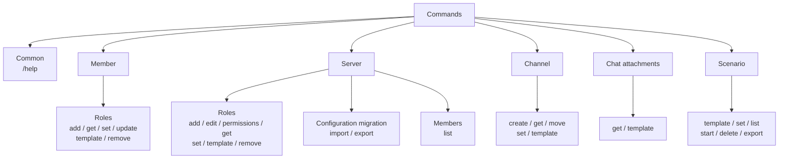

# DiscordBot_Servercontroller

## Overview

This is a Discord bot built with discord.py. It helps manage members, roles, channels, chat attachments, and scenario-based workflows in a Discord server.

## Setup

### Using the source code

1. Prepare Python 3.10 or later.
2. Install discord.py.

```powershell
pip install discord.py
```

3. Set the bot token in `Src/config/config.json`.

```json
{
  "BOT_TOKEN": "your bot token"
}
```

4. Enable the following intents in the Discord Developer Portal.
   - Message Content Intent
   - Server Members Intent
   - Reactions
   - Voice States

5. Start the bot.

```powershell
python Src/bot_main.py
```

### Tests

Install the development dependencies and run the tests from the repository root.

```powershell
python -m pip install -r requirements-dev.txt
python -m pytest
```

### Using the exe

If Python is not installed, use the exe in the `release` folder.

1. Set the bot token in `release/config/config.json`.

```json
{
  "BOT_TOKEN": "your bot token"
}
```

2. Run `release/DiscordBot_Servercontroller.exe`.

The exe version does not require Python or discord.py. Generated CSV and ZIP files are temporarily stored in `release/temp` and deleted after they are sent to Discord.

Do not expose the bot token, and avoid committing the configuration file to Git.

### Reminders

Add reminders to `Src/config/reminders.json` (or `release/config/reminders.json` for the exe). While the bot is running, it checks the file every 30 seconds and sends each reminder to its configured channel. Specify Japan time with an ISO 8601 `+09:00` offset, and use Discord IDs for the channel and mention targets.

```json
{
  "reminders": [
    {
      "id": "meeting-20261030",
      "datetime": "2026-10-30T19:00:00+09:00",
      "channel_id": "123456789012345678",
      "content": "The meeting is starting.",
      "mention_users": ["234567890123456789"],
      "mention_roles": ["345678901234567890"]
    }
  ]
}
```

Each `id` must be unique. Failed reminders remain in the configuration for retry. Successfully sent reminders are removed, and delivery results are appended to `config/reminder_log.jsonl`.

Users with Manage Server permission can use `/reminder add` to schedule a reminder and `/reminder remove` with the returned ID to cancel it before delivery. Enter the time as `YYYY-MM-DD HH:MM` in Japan time or as ISO 8601 with a `+09:00` offset.

To register multiple reminders, get a CSV from `/reminder template`, fill it in, and attach it to `/reminder import`. Required columns are `datetime`, `channel_id`, and `content`; optional columns are `mention_users` and `mention_roles`. Mention columns accept member display names or Discord usernames, and role names. Separate multiple targets with `;`. Names are matched case-insensitively and exactly within the current server; missing or ambiguous matches are rejected. Discord IDs remain supported. The entire CSV is validated before anything is added, existing reminders are preserved, and target channels and mention targets must belong to the current server.

For `/reminder add`, choose the user or role from Discord's selector; Discord passes its ID internally.

## Auxiliary GUI tools

Configuration, CSV, and server-export JSON editing are combined in the Server Configuration Editor. Start it from the repository root with Python or use `release/tools/server_config_editor.exe` on Windows.
### Server Configuration Editor

```powershell
python Src/tools/server_config_editor/server_config_editor.py
```

The application has Config, Template, Server role, Member role, Channel, Scenario, Reminder, and Server Export tabs. Click a list column heading to open an Excel-style dropdown with ascending/descending sorting, value search, and checkbox-based multi-value filtering. Filters on multiple columns combine, and blank values can be selected. Double-click template CSV cells to edit them. Member-role CSV formats are detected from their column names and validated on save. A tab with unsaved changes is marked with `*`, and closing the app asks for confirmation.

The server-role tab can edit role names, colors, and permissions, and add or remove permission columns. The member-role tab can add or remove role columns. The channel tab can add or remove `role_N` and `user_N` columns. The Scenario tab opens a CSV or a folder of CSVs and edits step instructions, completion conditions, responses, and branches. The Reminder tab can add, edit, and delete scheduled reminders and save the reminder JSON. The Server Export tab opens JSON produced by `/server export` and edits server roles, member roles, and channels. Secret values such as the bot token are masked in the Config tab.

The Python version uses `Src/templates` and `Src/config` by default. The Windows [server_config_editor.exe](../release/tools/server_config_editor.exe) uses files under `release` by default. Use the Open button in a tab to select another file. Never expose the settings file or commit it to Git.

## Commands

Commands are used as slash commands. Use `/help` to display all available commands.



### Common commands

```text
/help
```

### Member role commands

```text
/member role add @member role-name
/member role get username
/member role set + CSV-file
/member role update + member-list CSV
/member role template
/member role remove @member role-name
```

See `member_role_template.csv` in the [Template files](#template-files) section for the CSV format.

`get` returns the roles of the member matching the Discord username. A mention can also be used. It currently replies with text, not CSV. In the `set` CSV, `ユーザーID` takes priority; when blank, members are searched by `ユーザー名` and then `表示名`. CSVs in the previous format without an ID column remain supported.

Use multiple `ロールN` columns (such as `ロール1`, `ロール2`) to add or remove multiple roles in one row. The previous single `ロール` column remains supported. The result CSV includes `result` and `reason` columns.

`update` accepts an edited CSV from `/server member list` and replaces each member's roles with the entries in `Role1`, `Role2`, etc. It matches by `User ID` first; if that column is absent or blank, it searches by `Name` (Discord username), then `Display Name`. The result CSV includes `result` and `reason` columns. The default role and bot/integration-managed roles are preserved.

The `add`, `set`, `update`, and `remove` commands require the Manage Roles permission.

### Server role commands

```text
/server role add role-name
/server role edit role-name permission-name on|off
/server role edit role-name color #RRGGBB
/server role permissions
/server role get
/server role set + CSV-file
/server role template
/server role remove role-name
```

See `server_role_template.csv` in the [Template files](#template-files) section for the CSV format.

Use `/server role permissions` to download a CSV of permission names, English descriptions, Japanese translations, and allowed values (`on` / `off`).

The CSV returned by `/server role get` can be attached to `/server role set`. The result CSV includes `result` and `reason` columns.

The `add`, `edit`, `set`, and `remove` commands require the Manage Roles permission.

### Member list command

```text
/server member list
/server export
/server import + JSON-file
```

Exports the server member list as a CSV file with English column headers (`User ID`, `Name`, `Display Name`, `Role1`, `Role2`, etc.) and each role in its own column. Large CSV files are returned as ZIP archives to reduce upload time.

`/server export` downloads one JSON file containing server roles, each member's role assignments, and channel settings. It includes role permissions, channel types/categories/settings, and channel permission overwrites for roles and members. Both Manage Roles and Manage Channels permissions are required.

Attach this JSON to `/server import` to synchronize server settings with the snapshot. Before applying changes, the command first sends a rollback snapshot named `server_rollback_before_import_...json`. Attach that JSON to `/server import` to restore the pre-import state. If saving or sending the rollback file fails, the server is left unchanged. For migration to another server, roles are matched by name, members by username (then display name when needed), and channels by name and type; missing targets are created. Manageable roles and channels absent from the JSON are deleted, and channel permission overwrites and member-role assignments are replaced with the JSON values. Manageable roles are also removed from members absent from the JSON; members themselves are not deleted. Discord-managed roles and other settings the API cannot change are retained and reported in the result CSV. This operation changes and deletes server settings, so review the JSON in the dedicated editor before applying it. The command replies with a CSV recording each target's result and any failure reason. Both Manage Roles and Manage Channels permissions are required.

### Channel commands

```text
/channel create text channel-name [category-name]
/channel create voice channel-name [category-name]
/channel move #channel category-name
/channel get
/channel set + CSV-file
/channel template
```

Creating and moving channels requires the Manage Channels permission. If the target category does not exist, it is created automatically.

Use `/channel get` to export the server's channel list as `name,type,category` CSV.

This CSV can be attached to `/channel set`. Its result CSV includes `result` and `reason` columns. If any role columns are populated, only the listed roles retain channel access; existing grants for unlisted roles are removed. If all role columns are blank, existing role permissions remain unchanged. Optional `user_1`, `user_2`, and later columns accept Discord usernames and grant those members channel access without changing existing member-specific overwrites.

See `channel_template.csv` in the [Template files](#template-files) section for the CSV format.

Set `type` to `text` or `voice`. Existing channels are found by name and moved to the specified category; missing channels are created automatically.

### Chat attachment commands

```text
/chat get #text-channel [start-date YYYY-MM-DD] [extension]
/chat get + CSV-file
/chat template
```

Mention a channel to fetch attachments from that single channel. The optional start date uses `YYYY-MM-DD`; files from 00:00 UTC on that date onward are included. Extensions can be specified as `png` or `.png`, and multiple values can be provided like `png|jpg|gif`.

For multiple channels, set `category_name,channel_name,start_date,extension` in the CSV. Attachments from each channel are combined into a single ZIP file in the structure `category-name/channel-name/file-name`. Leave `start_date` or `extension` blank to skip that filter. The Manage Messages permission is required.

See `chat_template.csv` in the [Template files](#template-files) section for the CSV format.

### Event notification features

These are sample features and can be modified or disabled depending on your production requirements.

- Joining or leaving a voice channel sends a notification to that channel's text chat.
- When a new member joins, the event is written to the bot log.

### Scenario commands

```text
/scenario template
/scenario set + CSV-file
/scenario list
/scenario start scenario-id [start-step]
/scenario delete scenario-id
/scenario export
```

Scenario definitions are stored in `Src/config/scenario_definitions.json`, and per-server progress is stored in `Src/config/scenario_states.json`. `/scenario set` preserves existing scenarios and appends or updates entries from the CSV. If the same scenario ID and step number already exist, they are updated. It returns the CSV with `result` and `reason` columns. The CSV from `/scenario export` can be reused with `/scenario set`.

See `scenario_template.csv` in the [Template files](#template-files) section for the CSV format and the example `welcome` scenario.

When `completion_type` is `reaction`, the scenario advances when a reaction is added to the current instruction message. If `completion_value` is `*` or empty, any reaction is accepted; if it is a specific emoji, only that emoji is accepted. Sample reactions are automatically added to reaction-based instructions.

Multiple branches can be defined in one row using numbered `branch_reaction_N` and `branch_step_N` columns. Branch targets are limited to steps within the current scenario.

## Template files

CSV templates are grouped by purpose under `Src/templates`. Edit the needed CSV and attach it to the corresponding command.

### Set input

- [channel_template.csv](../Src/templates/set/input/channel_template.csv): Channel configuration
- [member_role_template.csv](../Src/templates/set/input/member_role_template.csv): Member role configuration
- [server_role_template.csv](../Src/templates/set/input/server_role_template.csv): Server role configuration
- [scenario_template.csv](../Src/templates/set/input/scenario_template.csv): Scenario registration
- [team_match_scenario.csv](../Src/templates/set/input/team_match_scenario.csv): Team match scenario example

### Get input

- [chat_template.csv](../Src/templates/get/input/chat_template.csv): Attachment retrieval across multiple channels

### Responses and results

- [Set response folder](../Src/templates/set/response/README.md): Set result CSV behavior
- [Get result folder](../Src/templates/get/result/README.md): Get output behavior

Response and result files are temporarily saved in `temp`, sent as Discord attachments, and then deleted.

## Licenses

- [Project license (MIT)](licenses/LICENSE)
- [Third-party OSS licenses](licenses/THIRD_PARTY_LICENSES.md)
